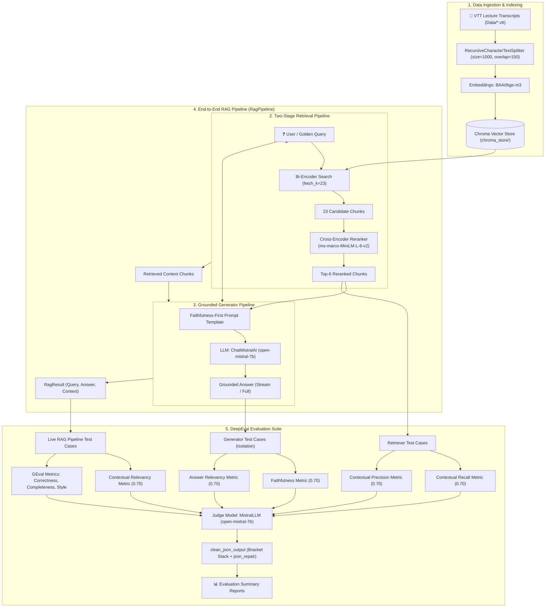

# LLM RAG Evaluation Engine 🚀

> **Comprehensive Two-Stage Retrieval, Grounded Generation & End-to-End RAG Triad Suite**
> Powered by **DeepEval**, **LangChain**, **ChromaDB**, **BAAI/bge-m3**, **Cross-Encoder Reranking**, and **Mistral AI**.

---

## 📋 Overview

This repository implements a production-grade **Retrieval-Augmented Generation (RAG) Evaluation Framework**. It is designed to evaluate, benchmark, and optimize document retrieval performance, LLM generation quality, and end-to-end RAG pipeline behavior across video transcripts (VTT format) from multi-session AI/LLM courses.

The framework combines a **two-stage retrieval pipeline** (Dense Bi-Encoder over-retrieval + Cross-Encoder re-scoring), a **faithfulness-first generator** powered by Mistral AI, an **end-to-end RAG pipeline orchestrator**, and automated **DeepEval Metrics** (Contextual Recall, Contextual Precision, Faithfulness, Answer Relevancy, and Contextual Relevancy) judged by `open-mistral-7b`.

---

## 🏗 System Architecture



---

## 📊 Evaluation Performance Benchmarks

### 1. Retriever Component Benchmarks (15 Reference Goldens)

Evaluated across **15 human-curated reference golden test cases** covering lecture sessions 1 to 9:

| Retrieval Configuration | Contextual Precision | Contextual Recall | Pass Rate (Recall) | Pass Rate (Precision) |
| :--- | :--- | :--- | :--- | :--- |
| **Baseline Vector Search (`k=5`)** | ~0.82 | ~0.61 | ~40.0% | ~80.0% |
| **Reranked (`fetch_k=20, top_k=6`)** | 0.9176 | 0.7311 | 46.7% (7/15) | 93.3% (14/15) |
| **Reranked (`fetch_k=25, top_k=7`)** | 0.8742 | 0.7507 | 60.0% (9/15) | 93.3% (14/15) |
| **Reranked (`fetch_k=25, top_k=6`, overlap=250)** | 0.8955 | 0.7577 | 73.3% (11/15) | 93.3% (14/15) |
| **Reranked Active Default (`fetch_k=23, top_k=6`, overlap=150)** 🏆 | **0.9047** | **0.7493** | **60.0% (9/15)** | **93.3% (14/15)** |

### 2. Generator Component Benchmarks (Isolated Context)

Evaluated in component isolation on known-good golden contexts using `ChatMistralAI(model="open-mistral-7b")`:

| Metric | Average Score | Pass Rate | Status |
| :--- | :--- | :--- | :--- |
| **Faithfulness Metric** | **0.9513** | **100.0% (15/15 passed)** | 🎉 100% PASS |
| **Answer Relevancy Metric** | **1.0000** | **100.0% (15/15 passed)** | 🎉 100% PASS |

### 3. End-to-End RAG Pipeline Benchmarks (RAG Triad)

Evaluated end-to-end on live retriever + generator output using `RagPipeline()`:

| RAG Triad Metric | Average Score | Pass Rate | Evaluation Focus |
| :--- | :--- | :--- | :--- |
| **Faithfulness** | **0.9914** | **100.0% (15/15 passed)** | 🎉 Zero Hallucination |
| **Answer Relevancy** | **0.9749** | **100.0% (15/15 passed)** | 🎉 High User Query Alignment |
| **Contextual Relevancy** | **0.5508** | **13.3% (2/15 passed)** | ⚠️ Penalizes conversational lecture noise |

### 4. Application Quality Benchmarks (15 GEval Test Cases)

Evaluated end-to-end using custom G-Eval rubrics and criteria (`Evals/eval_application.py`):

| Application Metric | Average Score | Pass Rate | Evaluation Focus |
| :--- | :--- | :--- | :--- |
| **Correctness [GEval]** | **0.9133** | **100.0% (15/15 passed)** | 🎉 Factually accurate claims vs ideal truth |
| **Completeness [GEval]** | **0.8400** | **93.3% (14/15 passed)** | 🎉 Coverage of key points in ideal answer |
| **Style [GEval]** | **0.9867** | **100.0% (15/15 passed)** | 🎉 Intuitive CampusX teaching voice & tone |

---

## ⭐ Key Technical Features & Optimizations

1. **Two-Stage Reranking Pipeline**:
   - **Stage 1 (Bi-Encoder Over-Retrieval)**: Uses `BAAI/bge-m3` to fast-retrieve `fetch_k = 23` candidate chunks from Chroma vector store.
   - **Stage 2 (Cross-Encoder Re-Scoring)**: Uses `cross-encoder/ms-marco-MiniLM-L-6-v2` to perform pairwise query-document re-scoring, filtering down to the top `top_k = 6` chunks.

2. **Faithfulness-First Grounded Generator**:
   - Powered by `ChatMistralAI(model="open-mistral-7b", temperature=0)`.
   - Employs strict system prompts instructing the model to answer *only* from context and abstain when context is insufficient.
   - Supports both non-streaming (`generate()`) and token-by-token streaming (`generate_stream()`) outputs.

3. **End-to-End RAG Orchestrator (`RagPipeline`)**:
   - Combines two-stage retrieval and Mistral generation into a unified `invoke(query)` interface returning structured `RagResult` dictionaries containing `query`, `answer`, and `context`.

4. **Apple Silicon (Mac M2) Hardware Safety**:
   - Caps PyTorch CPU thread usage (`torch.set_num_threads(4)`) and sets batch encoding size (`batch_size = 32`) to prevent CPU thread starvation and system freezing during heavy embedding tasks.

5. **Robust LLM Judge & Multi-Block JSON Repair System**:
   - Custom `MistralLLM` class extending DeepEval's `DeepEvalBaseLLM`.
   - Advanced `clean_json_output()` sanitizer featuring markdown fence stripping, bracket/brace stack extraction (`{...}` and `[...]`), and multi-block JSON array merging to handle open-source LLM formatting quirks.

6. **Synthetic Golden Generation**:
   - Automated creation of synthetic test cases using DeepEval's `Synthesizer` with evolution strategies (`Goldens/generate_goldens.py`).

---

## 📁 Repository Structure

```
.
├── Data/                             # VTT lecture transcripts
│   ├── YT Sandbox LLM Evals Session 1.vtt
│   ├── ...
│   └── YT Sandbox LLM Evals Session 9.vtt
├── Evals/                            # Evaluation harness & execution
│   ├── eval_retriever.py            # Retriever evaluation suite (Precision & Recall)
│   ├── eval_generator.py            # Generator evaluation suite (Faithfulness & Relevancy)
│   ├── eval_rag_pipeline.py         # End-to-End RAG Triad suite (Faithfulness, Relevancy, Contextual Relevancy)
│   ├── eval_application.py          # Application quality suite (Correctness, Completeness, Style)
│   └── harness.py                   # Metric summarization & reporting utilities
├── Goldens/                          # Reference and synthetic golden datasets
│   ├── retriever_goldens.json       # 15 human-authored retriever goldens
│   ├── faithfulness_dataset.json    # 15 human-authored generator goldens
│   ├── correctness_goldens.json     # 15 human-authored application goldens
│   ├── retriever_deepeval_goldens.json # Generated synthetic golden draft dataset
│   └── generate_goldens.py          # DeepEval Synthesizer script
├── src/                              # Core RAG implementation
│   ├── retriever.py                 # Ingestion, VTT parser, Chroma vector store
│   ├── reranker.py                  # Two-stage Cross-Encoder reranker
│   ├── generator.py                 # Grounded Mistral LLM generator & streaming
│   └── rag_pipeline.py              # End-to-end RAG pipeline class
├── chroma_store/                     # Local persisted ChromaDB store
├── pyproject.toml                    # Dependencies (uv / pyproject configuration)
└── README.md                         # Project documentation
```

---

## 🚀 Getting Started

### 1. Prerequisites
- Python **3.14** (or 3.10+)
- [`uv`](https://github.com/astral-sh/uv) package manager
- Mistral AI API Key

### 2. Environment Setup

Clone the repository and install dependencies:
```bash
uv sync
```

Create a `.env` file in the project root:
```env
MISTRAL_API_KEY=your_mistral_api_key_here
```

### 3. Build Vector Store & Test RAG Components

Ingest transcripts and build Chroma vector store:
```bash
uv run python src/retriever.py
```

Test the standalone Cross-Encoder reranker:
```bash
uv run python src/reranker.py
```

Test the Mistral generator (streaming & non-streaming):
```bash
PYTHONPATH=. uv run python src/generator.py
```

Test end-to-end RAG pipeline sample query:
```bash
PYTHONPATH=. uv run python src/rag_pipeline.py
```

---

## 🧪 Running Evaluations

### 1. Run Application Quality Evaluation (GEval: Correctness, Completeness, Style)
Execute custom G-Eval criteria evaluation on full pipeline output:
```bash
PYTHONPATH=. uv run python Evals/eval_application.py
```

### 2. Run End-to-End RAG Pipeline Evaluation (RAG Triad)
Execute full pipeline evaluation for Faithfulness, Answer Relevancy, and Contextual Relevancy:
```bash
PYTHONPATH=. uv run python Evals/eval_rag_pipeline.py
```

### 3. Run Generator Evaluation Suite (Faithfulness & Relevancy)
```bash
PYTHONPATH=. uv run python Evals/eval_generator.py
```

### 4. Run Two-Stage Reranked Retriever Evaluation (Recall & Precision)
```bash
PYTHONPATH=. uv run python Evals/eval_retriever.py --rerank
```

### 5. Run Baseline Retrieval (Single-Stage Vector Search)
```bash
PYTHONPATH=. uv run python Evals/eval_retriever.py
```

---

## 🧬 Generating Synthetic Golden Datasets

To synthesize new test cases from transcript context using DeepEval's `Synthesizer` and Mistral 7B:
```bash
uv run python Goldens/generate_goldens.py
```
The resulting synthetic goldens are saved to `Goldens/retriever_deepeval_goldens.json`.

---

## 🛠 Tech Stack

- **Frameworks**: [DeepEval](https://github.com/confident-ai/deepeval), [LangChain](https://github.com/langchain-ai/langchain)
- **Vector DB**: [ChromaDB](https://www.trychroma.com/)
- **Embeddings**: [`BAAI/bge-m3`](https://huggingface.co/BAAI/bge-m3)
- **Reranker**: [`cross-encoder/ms-marco-MiniLM-L-6-v2`](https://huggingface.co/cross-encoder/ms-marco-MiniLM-L-6-v2)
- **LLM Generator & Judge**: `open-mistral-7b` via [`langchain_mistralai`](https://github.com/langchain-ai/langchain-mistralai)
- **JSON Sanitization**: [`json-repair`](https://github.com/maitool/json-repair)
