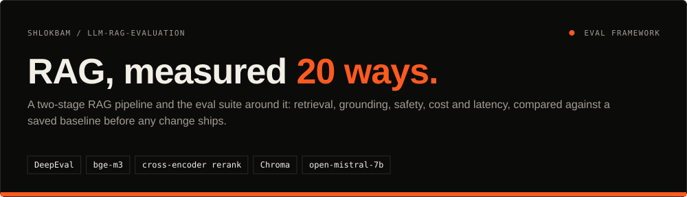
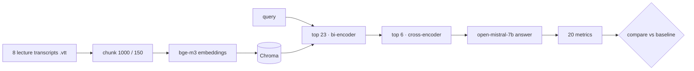
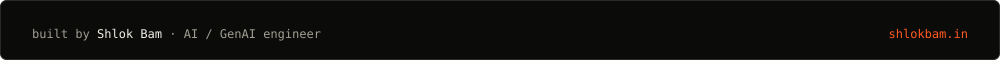

<div align="center">




<a href="#results">Results</a> · <a href="#how-it-works">How it works</a> · <a href="#quickstart">Quickstart</a> · <a href="#design-decisions">Decisions</a> · <a href="#limits--roadmap">Limits &amp; roadmap</a>

</div>

## In one minute

- **Problem:** a RAG demo that "works" says nothing about whether it retrieves the right chunks, stays grounded, resists attacks or fits a budget.
- **What this does:** runs a real RAG pipeline over 8 lecture transcripts and scores it on 20 tracked metrics, using 6 hand-built golden sets of 15 cases each plus a synthetic set.
- **Result:** 0.98 faithfulness and 0.95 retrieval precision at $0.00065 per query. Latency still misses its target, and the table says so.

## Results

Latest full-suite snapshot ([`baselines/candidate.json`](../baselines/candidate.json), commit `322badb`), judged by `open-mistral-7b`.

| Area | Metric | Score | Gate | Status |
| :--- | :--- | :--- | :--- | :--- |
| Retrieval | Contextual precision | **0.95** | ≥ 0.70 | ✅ pass |
| Retrieval | Contextual recall | **0.73** | ≥ 0.70 | ✅ pass |
| Generation | Faithfulness (end to end) | **0.98** | ≥ 0.70 | ✅ pass |
| Generation | Answer relevancy | **0.97** | ≥ 0.70 | ✅ pass |
| Generation | Contextual relevancy | **0.60** | ≥ 0.70 | ⚠️ below gate |
| Application | Correctness · completeness · style (G-Eval) | **0.93 · 0.87 · 0.99** | ≥ 0.70 | ✅ pass |
| Safety | Toxicity · scope adherence | **15/15 each** | ≤ 0.30 · ≥ 0.70 | ✅ pass |
| Cost | Cost per query | **$0.00065** | ≤ $0.0015 | ✅ pass |
| Latency | End-to-end p95 | **11.4 s** | ≤ 3 s | ⚠️ fails target |
| Reliability | Success rate, 20 runs | **100%** | ≥ 99% | ✅ pass |

Every per-metric table, golden-set schema and rubric: **[docs/RESULTS.md](../docs/RESULTS.md)**.

## How it works



| Part | What it does |
| :--- | :--- |
| `Src/retriever.py`, `Src/reranker.py` | Two-stage retrieval: dense search, then cross-encoder rerank |
| `Src/generator.py`, `Src/rag_pipeline.py` | Faithfulness-first prompt and the end-to-end pipeline |
| `Goldens/` | Golden sets: retrieval, faithfulness, correctness, toxicity, leakage, scope, plus a synthetic set |
| `Evals/run_suite.py` | Runs every metric and saves a snapshot |
| `Evals/compare.py` | Diffs a snapshot against the baseline and flags regressions |

## Quickstart

Needs Python 3.14+, [uv](https://github.com/astral-sh/uv) and a Mistral API key.

```bash
uv sync
echo "MISTRAL_API_KEY=your_key" > .env

# score the pipeline on all 20 metrics
PYTHONPATH=. uv run python -m Evals.run_suite --label "candidate"

# compare against the saved baseline: pass / regress per metric
PYTHONPATH=. uv run python -m Evals.compare
```

Each metric also runs on its own, for example `PYTHONPATH=. uv run python Evals/eval_retriever.py --rerank`. The full list is in [docs/RESULTS.md](../docs/RESULTS.md).

## Design decisions

- **Over-retrieve, then rerank.** Fetching 23 chunks and keeping the top 6 after a cross-encoder lifted precision from about 0.82 (plain top-5) to 0.90, at the cost of about 5 s per query.
- **A 7B judge needs a JSON repair step.** `open-mistral-7b` often returns broken JSON, so every verdict goes through a bracket-stack cleaner before it is scored.
- **Gates, not vibes.** Each metric has a threshold, and `compare.py` reports any metric that drops below its baseline.

## Limits & roadmap

- [ ] Bring p95 latency from 11.4 s toward 3 s (smaller rerank pool, stream the first token sooner)
- [ ] Raise contextual relevancy (0.60): the lecture transcripts are conversational and noisy
- [ ] Run `compare.py` in GitHub Actions on every pull request

---

<div align="center">

<a href="https://shlokbam.in"></a>

<a href="https://shlokbam.in">shlokbam.in</a> · <a href="https://www.linkedin.com/in/shlokbam/">LinkedIn</a> · <a href="https://github.com/shlokbam">More projects</a>

</div>
